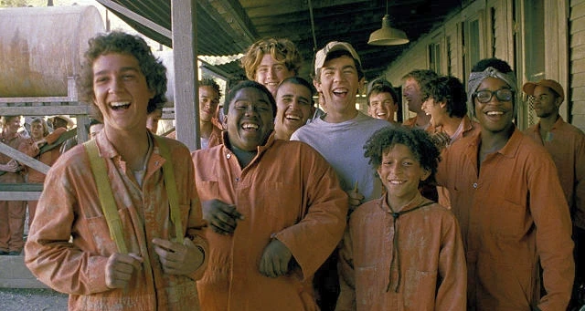
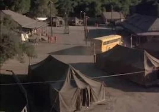
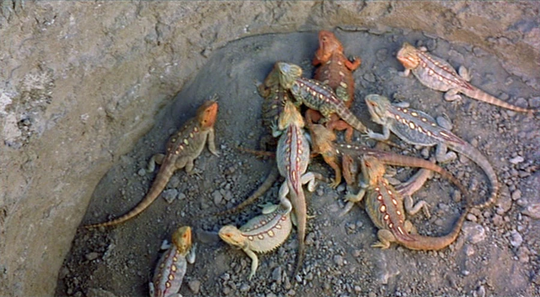
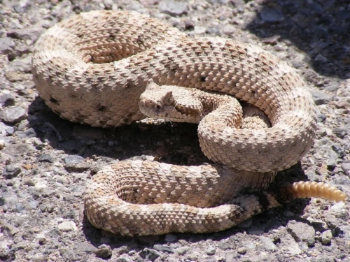
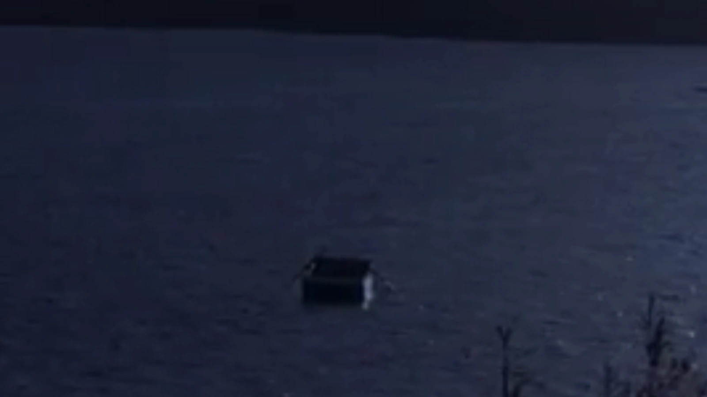
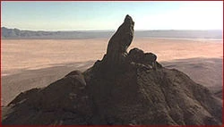

# Camp Green Lake — Setting, Geography, History, and Desert Ecology

Camp Green Lake is the central physical and psychological landscape of Louis Sachar's *Holes*. Defined by bitter irony and stark paradox, the camp features no lake, no verdant greenery, and no recreational activities. It is an inhospitable, sun-scorched juvenile labor camp set upon an ancient dried lakebed in Texas. This study document provides an exhaustive geographical, historical, structural, and ecological analysis for secondary literature examinations.

---

## Table of Contents
1. [The Environmental History of Green Lake, Texas](#the-environmental-history-of-green-lake-texas)
   - [The Prosperous 19th-Century Lake Town (circa 1880–1888)](#the-prosperous-19th-century-lake-town-circa-18801888)
   - [The Murder of Sam and the 110-Year Drought](#the-murder-of-sam-and-the-110-year-drought)
2. [Camp Green Lake as an Exploitative Penal Institution](#camp-green-lake-as-an-exploitative-penal-institution)
   - [The Illusion of Character Building vs. Systematic Forced Labor](#the-illusion-of-character-building-vs-systematic-forced-labor)
   - [The Inflexible Hole-Digging Regime (5x5 Feet)](#the-inflexible-hole-digging-regime-5x5-feet)
   - [The Daily Operational Schedule](#the-daily-operational-schedule)
3. [Camp Ground Plan and Critical Structural Landmarks](#camp-ground-plan-and-critical-structural-landmarks)
   - [Tent D and the Living Quarters](#tent-d-and-the-living-quarters)
   - [The Wreck Room (Decaying Recreational Center)](#the-wreck-room-decaying-recreational-center)
   - [The Warden's Air-Conditioned Compound and Office](#the-wardens-air-conditioned-compound-and-office)
   - [The Two Oak Trees and the Exclusive Hammock Shade](#the-two-oak-trees-and-the-exclusive-hammock-shade)
4. [Desert Ecology: Fauna and Flora](#desert-ecology-fauna-and-flora)
   - [The Deadly Yellow-Spotted Lizard (*11 Yellow Spots, Fatal Bite*)](#the-deadly-yellow-spotted-lizard-11-yellow-spots-fatal-bite)
   - [Rattlesnakes and Scorpions](#rattlesnakes-and-scorpions)
   - [Wild Mountain Onions (*Allium*) and Medicinal Properties](#wild-mountain-onions-allium-and-medicinal-properties)
5. [Critical Landmarks Across the Surrounding Wasteland](#critical-landmarks-across-the-surrounding-wasteland)
   - [The Endless Hole Field (The Lunar Lakebed)](#the-endless-hole-field-the-lunar-lakebed)
   - [The Wreck of the *Mary Lou*](#the-wreck-of-the-mary-lou)
   - [God's Thumb (Big Thumb Mountain Sanctuary)](#gods-thumb-big-thumb-mountain-sanctuary)

---

## The Environmental History of Green Lake, Texas

*The vast, cracked salt flats of what was once the largest natural freshwater lake in Texas.*

### The Prosperous 19th-Century Lake Town (circa 1880–1888)
More than a century before Stanley Yelnats arrived, Green Lake was a thriving, postcard-perfect community nestled along the shores of the largest natural freshwater lake in the state of Texas. Fed by natural mountain runoff, the water was clear and cool, bordered by expansive orchards of peach trees that blossomed vividly every spring.

The civic life of Green Lake was celebrated for its annual Town Picnics, where townspeople gathered to sample local delicacies. Schoolteacher Katherine Barlow reigned supreme, repeatedly winning blue ribbons for her renowned canned spiced peaches, preserved with aromatic cinnamon, cloves, and sugar. The town economy prospered through fishing, agriculture, and waterborne commerce. Wealthy families like the Walkers held vast estates, and Charles "Trout" Walker dominated the lake in a newly imported, gasoline-powered motorboat.

### The Murder of Sam and the 110-Year Drought
The ecological destruction of Green Lake was inextricably linked to human sin, racial prejudice, and mob violence. When the white schoolteacher Katherine Barlow kissed Sam, a Black onion peddler, the entrenched racial hatred of 1888 Texas surfaced with murderous fury. Led by the humiliated Trout Walker, a vigilante mob burned the town schoolhouse to the ground. When Sam and Katherine attempted to escape across the water in his wooden rowboat, Trout intercepted them with his motorized vessel; Sam was executed in cold blood on the water, and his donkey Mary Lou was shot dead.

From the precise afternoon of Sam's murder, **not a single drop of rain fell on Green Lake for one hundred and ten years**. The sky remained a merciless, cloudless vault. The giant lake gradually evaporated into a barren salt pan, the peach orchards withered into lifeless gray sticks, homes rotted into ruins, and the population abandoned the ghost town. The lush paradise was supernaturally transformed into a desolate, punishing desert.

---

## Camp Green Lake as an Exploitative Penal Institution

*The deceptively rustic entrance marker to Camp Green Lake.*

### The Illusion of Character Building vs. Systematic Forced Labor
In the twentieth century, the Walker family recognized an opportunity to exploit both their desiccated wasteland and the Texas juvenile justice system. Louise Walker (The Warden) established a specialized correctional camp for juvenile male offenders.

To judges, probation officers, and the public, Camp Green Lake presented itself as a pioneering reformatory program rooted in strenuous physical discipline:
> *"If you take a bad boy and make him dig a hole every day in the hot sun, it turns him into a good boy. That's character building."*

In reality, the "character building" ideology was a cynical cover for unpaid, forced penal excavation. The Warden possessed zero interest in rehabilitation; her sole obsession was uncovering the buried fortune of outlaw Kissin' Kate Barlow. By compelling dozens of juvenile prisoners to systematically dig up the dry lakebed six days a week, she conducted a massive archaeological excavation at state expense.

*Campers toiling under the scorching 95-degree heat to excavate their daily holes.*

### The Inflexible Hole-Digging Regime (5x5 Feet)
Life at Camp Green Lake is governed by rigorous, unyielding mandates:
1. **Dimensions of the Hole**: Every boy must dig one hole per day, seven days a week, exactly five feet deep and five feet wide in every direction. The camper's shovel serves as the sole measuring instrument.
2. **Absence of Fences or Armed Guard Towers**: There are no physical barricades or electrified wires enclosing Camp Green Lake. As Mr. Sir bluntly explains: *"We don't need fences. We've got the only water for a hundred miles. You want to run? Go ahead. In three days you'll be buzzard food."*
3. **Incentive for Discoveries**: If a boy uncovers anything deemed "interesting" by the Warden, he is granted the remainder of the day off and a double shower ration.
4. **Water Rations**: The camp water truck visits the digging fields periodically. Insubordination or counselor displeasure results in campers having their canteens withheld or dumped into the dirt.

### The Daily Operational Schedule
- **04:30 AM**: Reveille. Campers awaken in pitch-black darkness while temperatures are relatively cool.
- **05:00 AM**: Breakfast in the mess hall (typically bland gruel, dry toast, and watered-down juice).
- **05:30 AM**: Departure to the digging fields with shovels and two-quart canteens. Campers immediately confront the rock-hard top crust of the baked clay lakebed.
- **Morning**: An intense race against the rising sun. By mid-morning, temperatures consistently exceed 95 to 105 degrees Fahrenheit in the open wasteland.
- **Afternoon**: Upon finishing their five-foot crater, campers thrust their shovels upright into their dirt mounds and march back to camp for an exact four-minute cold shower.

---

## Camp Ground Plan and Critical Structural Landmarks

### Tent D and the Living Quarters
Six large canvas army surplus tents (labeled A through F) house approximately seven boys each under the supervision of a dedicated counselor. Tent D accommodates Stanley Yelnats IV, Zero, X-Ray, Armpit, Magnet, Zigzag, and Squid. The tents sit on crude wooden pallets, furnished only with metal cot frames and threadbare mattresses. Dust and scorching air circulate constantly, offering no privacy and minimal rest.

### The Wreck Room (Decaying Recreational Center)
The recreational lounge is a monument to institutional neglect and vandalism. Its pool table is covered with torn green felt, the furniture is splintered with missing legs, and a ruined television set sits lifeless in the corner. The walls are covered in crude graffiti, carvings of names, and tally marks of sentences.

### The Warden's Air-Conditioned Compound and Office
A well-maintained wooden bungalow equipped with luxury modern air conditioning sits isolated from the campers' tents. Inside her private office, the Warden keeps camper dossiers, administrative records, and her specialized cosmetic vanity containing rattlesnake venom polish.

### The Two Oak Trees and the Exclusive Hammock Shade
Near the Warden's cabin grow two massive, ancient live oak trees. They represent the **only living trees** and the **only natural shade** on the entire camp reservation. A hammock is slung between their trunks.
- **The Absolute Commandment**: The shade and hammock belong solely and exclusively to the Warden. Any camper caught trespassing into the shade risks immediate gunfire from guards armed with shotguns.

---

## Desert Ecology: Fauna and Flora

*The dreaded Yellow-Spotted Lizard — the apex lethal threat of Camp Green Lake.*

### The Deadly Yellow-Spotted Lizard (*Yellow-Spotted Lizard*)
The most lethal predator inhabiting the Green Lake desert:
- **Anatomy & Appearance**: Approximately 6 to 10 inches in length, featuring a greenish-brown body covered in exactly **11 yellow spots**. It possesses bright yellow eyes ringed with crimson red, a milky white tongue, and razor-sharp black teeth.
- **Proverb**: *"If you're close enough to count the eleven yellow spots, you're already dead."*
- **Lethality**: Its venom is **100% fatal**, with no known medical antivenom. A single bite causes intense systemic agony, hallucinations, and rapid death.
- **Habitat**: Lizards prefer cool, dark hollows to escape the desert heat, making freshly excavated five-foot holes ideal nesting sites. They feed primarily on sunflower seed shells, insects, and small rodents.
- **Critical Vulnerability: Onion Blood**: Yellow-spotted lizards possess an absolute, instinctive revulsion to the smell and sulfur chemistry of **onions**. Humans who consume copious quantities of wild mountain onions absorb the chemical compounds into their bloodstream and skin pores, creating complete immunity from lizard attacks.

*Prairie rattlesnake in the scrub brush of the Texas badlands.*

### Rattlesnakes and Scorpions
The desert floor teems with western diamondback rattlesnakes and bark scorpions. The camp leadership regards these creatures with casual unconcern, offering a grim reassurance to inmates:
> *"If you get bitten by a scorpion or a rattlesnake, you won't die. You'll spend three days in agony with fever, vomiting, and chills, but you'll survive. But if you get bitten by a yellow-spotted lizard, don't bother going to the hospital."*

### Wild Mountain Onions (*Allium*)
Growing atop the high plateau of Big Thumb mountain, a thriving field of wild mountain onions survives because of a natural subterranean freshwater spring. These onions provide moisture, carbohydrates, vitamin C, and sulfurous compounds that revitalize Stanley and Zero while neutralizing the threat of lizard venom.

---

## Critical Landmarks Across the Surrounding Wasteland

### The Endless Hole Field (The Lunar Lakebed)
Extending outward for miles in all directions, tens of thousands of excavated pits pockmark the ancient lakebed. Viewed from an elevation, the landscape resembles the cratered surface of the moon — a testament to a century of futile human greed.

### The Wreck of the *Mary Lou*

*The overturned hull of Sam's 19th-century wooden rowboat Mary Lou on the dry lakebed.*

Located miles across the salt flats, the overturned, weathered wooden hull of Sam's rowboat *Mary Lou* lies half-buried beneath shifting sand dunes. Beneath its rotting hull, Zero discovers a cool microclimate and dozens of preserved mason jars of Kate Barlow's 110-year-old spiced peaches ("Sploosh"), which sustain him after his escape from camp.

### God's Thumb (Big Thumb Mountain Sanctuary)

*The iconic rock formation resembling a giant fist with an upturned thumb on the distant horizon.*

Towering against the distant mountain ridge, Big Thumb resembles an enormous stone fist extending an upturned thumb toward the sky:
- **Historical Haven**: The sanctuary where Stanley Yelnats I survived after being stranded in the desert by Kissin' Kate Barlow.
- **Physical Reality**: Houses a hidden high-altitude ecosystem nourished by a bubbling freshwater spring and Sam's ancient onion garden. It is the sacred site where Stanley carries Zero, breaking the century-old ancestral curse and initiating physical and spiritual resurrection.
