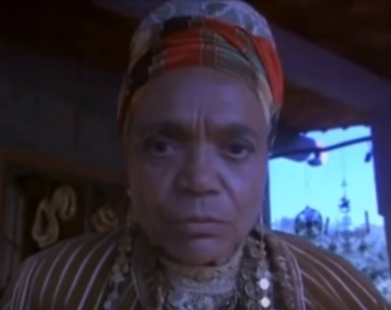
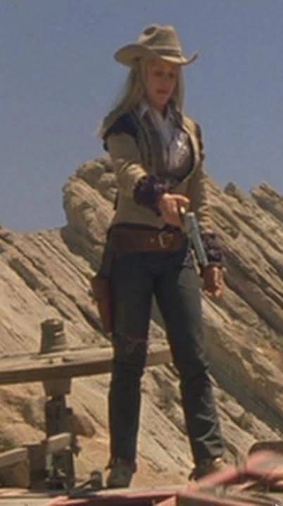
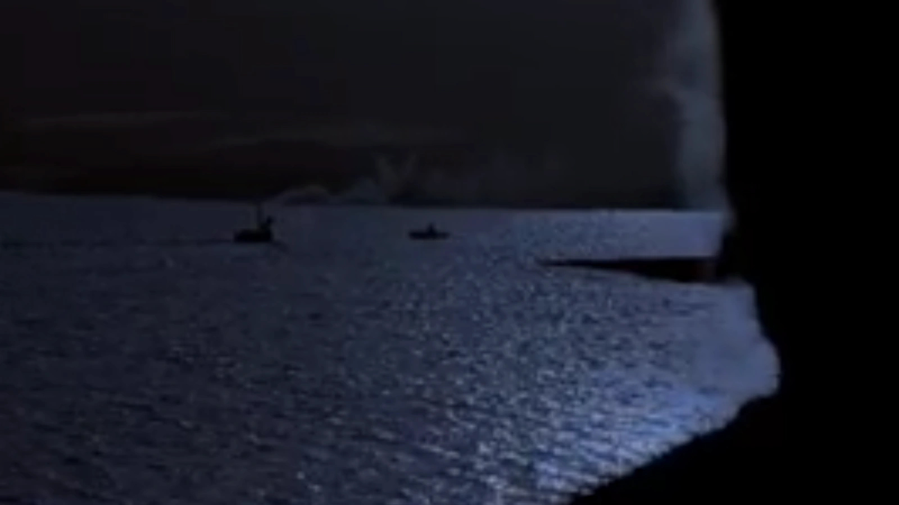
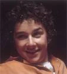
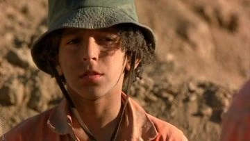
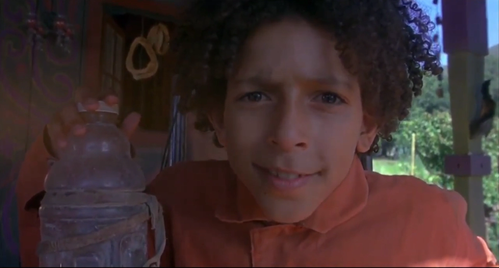
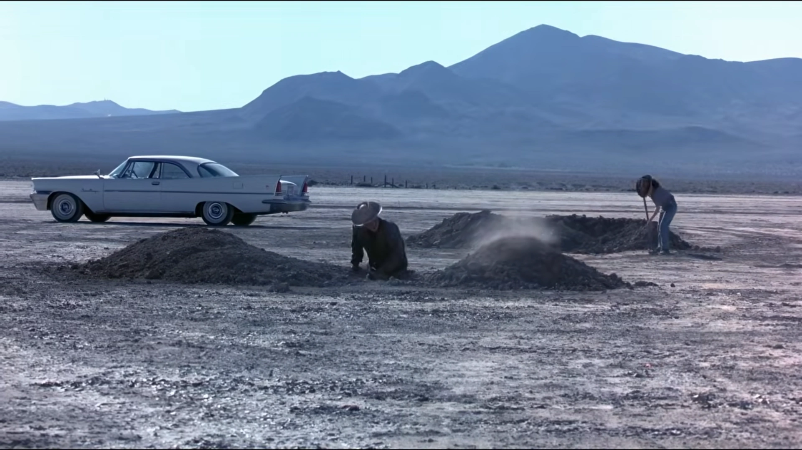

# Holes – Het Volledige Plot, Drie Verhaallijnen en de Cirkel van het Lot

Het verhaal van *Holes* is een meesterlijk vlechtwerk van drie verschillende historische tijdlijnen die zich over meer dan een eeuw uitstrekken. Wat aanvankelijk losse verhalen lijken over pech, folklore en een jeugdkamp, blijkt een nauwkeurig geconstrueerde cirkel van karma, gerechtigheid en verlossing. Dit document beschrijft alle drie de verhaallijnen en toont aan hoe ze samensmelten tot één samenhangend geheel.

---

## Inhoudsopgave
1. [De Drie Tijdlijnen in Vogelvlucht](#de-drie-tijdlijnen-in-vogelvlucht)
2. [Tijdlijn 1: Letland (Midden 19e Eeuw) – De Oorsprong van de Vloek](#tijdlijn-1-letland-midden-19e-eeuw--de-oorsprong-van-de-vloek)
   - [Elya Yelnats en Myra Menke](#elya-yelnats-en-myra-menke)
   - [Het Pact met Madame Zeroni](#het-pact-met-madame-zeroni)
   - [De Verbroken Belofte en de Vlucht naar Amerika](#de-verbroken-belofte-en-de-vlucht-naar-amerika)
3. [Tijdlijn 2: Green Lake, Texas (Eind 19e Eeuw) – De Tragedie van Kate Barlow](#tijdlijn-2-green-lake-texas-eind-19e-eeuw--de-tragedie-van-kate-barlow)
   - [De Verboden Liefde tussen Katherine en Sam](#de-verboden-liefde-tussen-katherine-en-sam)
   - [De Moord op Sam en het Begin van de 110-Jarige Droogte](#de-moord-op-sam-en-het-begin-van-de-110-jarige-droogte)
   - [De Wraak van Kissin' Kate Barlow](#de-wraak-van-kissin-kate-barlow)
   - [De Beroving van Stanley Yelnats I](#de-beroving-van-stanley-yelnats-i)
   - [De Confrontatie met de Walkers en de Dood door de Hagedis](#de-confrontatie-met-de-walkers-en-de-dood-door-de-hagedis)
4. [Tijdlijn 3: Het Heden bij Camp Green Lake](#tijdlijn-3-het-heden-bij-camp-green-lake)
   - [De Onterechte Veroordeling van Stanley Yelnats IV](#de-onterechte-veroordeling-van-stanley-yelnats-iv)
   - [Het Leven en Zwoegen in Tent D](#het-leven-en-zwoegen-in-tent-d)
   - [Vondsten in het Zand: Het Fossiel en het Lippenstiftbuisje ("KB")](#vondsten-in-het-zand-het-fossiel-en-het-lippenstiftbuisje-kb)
   - [De Vriendschap en het Pact tussen Stanley en Zero](#de-vriendschap-en-het-pact-tussen-stanley-en-zero)
   - [Escalatie, Geweld en de Vlucht van Zero](#escalatie-geweld-en-de-vlucht-van-zero)
   - [Stanley's Reddingsactie en de Tocht naar God's Thumb](#stanleys-reddingsactie-en-de-tocht-naar-gods-thumb)
   - [Het Verbreekt van de Vloek: Zero de Berg Op Dragen](#het-verbreekt-van-de-vloek-zero-de-berg-op-dragen)
   - [De Terugkeer naar het Kamp en de Opgraving van de Schatkist](#de-terugkeer-naar-het-kamp-en-de-opgraving-van-de-schatkist)
   - [De Nacht in de Kuil vol Dodelijke Hagedissen](#de-nacht-in-de-kuil-vol-dodelijke-hagedissen)
   - [Rechtvaardigheid, Vrijlating en Regen na 110 Jaar](#rechtvaardigheid-vrijlating-en-regen-na-110-jaar)
5. [De Cirkel van het Lot: Hoe Alles Samenkomt](#de-cirkel-van-het-lot-hoe-alles-samenkomt)

---

## De Drie Tijdlijnen in Vogelvlucht

| Tijdlijn | Periode & Locatie | Hoofdfiguren | Kerngebeurtenis |
|---|---|---|---|
| **Tijdlijn 1** | ~1850, Riga (Letland) | Elya Yelnats, Madame Zeroni | De verbroken belofte veroorzaakt de familievloek |
| **Tijdlijn 2** | ~1888, Green Lake (Texas) | Katherine Barlow, Sam, Trout Walker | Moord op Sam veroorzaakt de 110-jarige droogte; Kate begraaft schat |
| **Tijdlijn 3** | Heden, Camp Green Lake | Stanley Yelnats IV, Hector Zeroni | Stanley draagt Zero de berg op; vloek en droogte worden opgeheven |

---

## Tijdlijn 1: Letland (Midden 19e Eeuw) – De Oorsprong van de Vloek

*Madame Zeroni waarschuwt Elya Yelnats voor de vloek.*

### Elya Yelnats en Myra Menke
Het verhaal begint in een klein boerendorpje nabij Riga in Letland. De vijftienjarige Elya Yelnats wordt hopeloos verliefd op de beeldschone Myra Menke. Myra is echter oppervlakkig en naïef: haar vader Morris Menke beschrijft haar hoofd als "zo leeg als een bloempot". Ook de oudere en welvarende varkensboer Igor Barkov wil met Myra trouwen en biedt haar vader zijn vetste varken aan. Elya heeft niets om te bieden.

### Het Pact met Madame Zeroni
In zijn wanhoop klopt Elya aan bij zijn oude vriendin Madame Zeroni, een wijze Egyptische vrouw die geen voeten meer heeft. Madame Zeroni raadt hem met klem af om met Myra te trouwen: Myra kan niet nadenken, kan niet koken en heeft geen praktisch verstand. Elya weigert te luisteren.

Madame Zeroni besluit hem toch te helpen, maar stelt een strikt ritueel voor:
1. Ze geeft Elya een klein, pasgeboren biggetje.
2. Elya moet het varkentje elke dag op zijn rug een steile berg op dragen naar een zuivere bergstroom.
3. Terwijl het biggetje drinkt, moet Elya een speciaal slaapliedje voor het dier zingen.
4. Elke dag wordt het varkentje zwaarder en groeit Elya's spierkracht evenredig mee.
5. **De Belofte**: Op de dag van Myra's vijftiende verjaardag moet Elya, na het tonen van zijn varken, terugkeren naar Madame Zeroni. Hij moet **haar** op zijn rug de berg op dragen naar de bron, zodat ook zij kan drinken en het lied kan horen.

Madame Zeroni spreekt een duistere waarschuwing uit:
> *"Als je dit vergeet, zullen jij en al je nakomelingen tot in de eeuwigheid vervloekt zijn met pech en tegenspoed!"*

### De Verbroken Belofte en de Vlucht naar Amerika
Op de beslissende dag wegen het varken van Elya en dat van Igor allebei precies vijftig stenen. Vader Menke kan niet kiezen. Myra stelt domweg voor dat ze een getal tussen één en tien raden. 

Gedesillusioneerd realiseert Elya zich dat Madame Zeroni gelijk had: Myra houdt van niemand. Hij zegt bitter: *"Houd het varken maar als huwelijkscadeau voor Igor"* en vertrekt. Met een gebroken hart monsterde hij direct aan op een Amerikaans vrachtschip om naar de Nieuwe Wereld te varen. 

Pas midden op de Atlantische Oceaan schiet het door zijn hoofd: **hij is Madame Zeroni vergeten de berg op te dragen**. Hij probeert zichzelf gerust te stellen met de gedachte dat het slechts een bijgeloof was, maar vanaf dat moment kleeft de pech aan zijn schoenen. In Amerika trouwt hij met de wijze Sarah Miller en sticht hij het geslacht Yelnats, maar elke generatie wordt achtervolgd door bizarre tegenslagen.

---

## Tijdlijn 2: Green Lake, Texas (Eind 19e Eeuw) – De Tragedie van Kate Barlow

*Katherine Barlow voordat haar leven verwoest werd door de tragedie.*

### De Verboden Liefde tussen Katherine en Sam
Rond 1888 is Green Lake een bloeiende oase. Katherine Barlow is de alom gerespecteerde dorpsonderwijzeres. Ze is zachtaardig, leert zowel kinderen als volwassenen lezen, en bakt de lekkerste ingemaakte perziken van Texas. De rijkste man van de stad, Charles "Trout" Walker, probeert haar te veroveren, maar zij wijst hem publiekelijk af.

Katherine raakt bevriend met Sam de Uienman, die met zijn ezel Mary Lou dagelijks door het dorp trekt. Sam helpt haar met het herstellen van de lekkende school: hij vervangt het dak, repareert de ramen en lapt de vloer op. Bij elk probleem glimlacht hij en zegt: *"I can fix that."* De vriendschap slaat om in diepe wederzijdse liefde. Op een regenachtige middag kussen ze elkaar bij het schoolplein.

### De Moord op Sam en het Begin van de 110-Jarige Droogte
Hattie Parker ziet de kus en roept verontwaardigd: *"God zal jullie straffen!"* In die tijd was een liefdesrelatie tussen een zwarte man en een witte vrouw bij wet verboden in Texas. Een woedende meute, aangevoerd door Trout Walker, stelt de school in brand en wil Sam lynchen.

Katherine zoekt wanhopig hulp bij de sheriff, maar treft hem dronken aan. De sheriff weigert in te grijpen en eist zelfs een kus van Katherine in ruil voor bescherming. Katherine vlucht naar het meer, waar Sam haar opwacht in zijn roeiboot Mary Lou. 

*Trout Walker executeert Sam op het meer.*

Trout Walker achterhaalt de roeiboot met zijn snelle motorboot. Sam wordt op het water doodgeschoten en Mary Lou wordt geëxecuteerd. Katherine wordt gered tegen haar wil. Vanaf dat exacte moment houdt de regen op met vallen. De hemel sluit zich en Green Lake verandert in een dorre zoutvlakte.

### De Wraak van Kissin' Kate Barlow
Drie dagen na de moord stapt Katherine het kantoor van de sheriff binnen en schiet hem dood. Ze stift haar lippen met felle lippenstift en kust hem op zijn voorhoofd: de beruchte outlaw **Kissin' Kate Barlow** is geboren.

Twintig jaar lang trekt ze plunderend door het Zuidwesten. Ze overvalt banken, postkoetsen en treinen, en laat op elk mannelijk slachtoffer haar rode lipstickkus achter. 

*Stanley Yelnats I wordt beroofd door Kissin' Kate Barlow.*

Een van haar slachtoffers is **Stanley Yelnats I** (de zoon van Elya). Hij heeft zojuist zijn fortuin op de New Yorkse beurs verzilverd en reist met een zware kist vol effecten en contanten naar Californië. Kate overvalt zijn koets, steelt de kist met de inscriptie *"STANLEY YELNATS"*, maar weigert hem te kussen of te doden: ze laat hem zonder water achter in de woestijn. Stanley I overleeft wonderbaarlijk door toevlucht te zoeken op "God's Thumb".

### De Confrontatie met de Walkers en de Dood door de Hagedis
Twintig jaar na de moord op Sam keert een vermoeide Katherine terug naar het verlaten, uitgedroogde Green Lake. Ze verbergt de gestolen kist diep in de opgedroogde meerbodem.

Trout Walker en zijn straatarme vrouw Linda Miller (een voormalig leerlingetje van Katherine) ontdekken haar aanwezigheid. Ze binden haar vast en eisen onder schot dat ze de vindplaats van haar buit aanwijst. Voordat ze haar kunnen martelen, wordt Katherine in haar blote voet gebeten door een dodelijke gele vlekkenhagedis. Terwijl het gif haar verlamt, lacht ze Trout en Linda triomfantelijk uit:
> *"Start digging! You, and your children, and your children's children can dig for the next hundred years and you will never find it!"*

Ze sterft met een glimlach op haar lippen. De Walkers beginnen verwoed te graven – een zinloze queeste die generaties zal duren.

---

## Tijdlijn 3: Het Heden bij Camp Green Lake

*Stanley Yelnats IV arriveert in Camp Green Lake.*

### De Onterechte Veroordeling van Stanley Yelnats IV
In het heden wordt de veertienjarige Stanley Yelnats IV slachtoffer van de zoveelste bizarre samenloop van omstandigheden. Terwijl hij onder een snelwegviaduct loopt, vallen er plotseling een paar versleten sneakers op zijn hoofd. Het zijn de beroemde schoenen van Clyde "Sweet Feet" Livingston. Stanley denkt dat het een geluksdag is en rent naar huis om ze aan zijn vader te geven. De politie arresteert hem op heterdaad. Omdat zijn familie geen dure advocaat kan betalen, veroordeelt de rechter hem tot 18 maanden Camp Green Lake.

### Het Leven en Zwoegen in Tent D
In Camp Green Lake wordt Stanley ingedeeld in Tent D. Hij krijgt de bijnaam "Caveman". De fysieke ontberingen zijn immens: elke dag 5 voet diep en 5 voet breed graven in de brandende zon. 

Al snel doet Stanley twee opmerkelijke vondsten:
1. Een versteend fossiel van een vis (afgewezen door Mr. Pendanski omdat The Warden geen interesse heeft in fossielen).
2. Een klein gouden kokertje met een hartje en de letters **"KB"** erin gegraveerd (in werkelijkheid de lippenstifthuls van Kate Barlow). Op aandringen van groepsleider X-Ray staat Stanley de vondst aan hem af.

Wanneer X-Ray de buis inlevert, raakt The Warden geëxploiteerd van opwinding. Ze laat de jongens dagenlang rond X-Ray's gat graven, zonder te weten dat Stanley de buis tientallen meters verderop heeft gevonden.

### De Vriendschap en het Pact tussen Stanley en Zero
Stanley ontdekt dat Hector Zeroni ("Zero") niet kan lezen of schrijven. Zero stelt een ruil voor: als Stanley hem leert lezen, graaft Zero elke dag een deel van Stanley's gat. Het verbond werkt perfect: Zero blijkt uitzonderlijk snel te leren en Stanley houdt energie over.

De andere jongens in Tent D reageren echter jaloers en vijandig. Tijdens een groepsgesprek jut Dr. Pendanski Zigzag op om Stanley aan te vallen. Er ontstaat een brute vechtpartij. Wanneer Zero ingrijpt en Zigzag in een wurggreep neemt, trekken de kampleiders hun wapens. Pendanski vernedert Zero publiekelijk: *"Zero is te dom om te leren. Je kunt net zo goed deze schep leren lezen."* 

Zero kan het niet langer verdragen, slaat Pendanski met zijn schep neer en verdwijnt de zinderende woestijn in.

*Zero dwaalt door de dodelijke zoutpan na zijn vlucht.*

### Stanley's Reddingsactie en de Tocht naar God's Thumb
The Warden en Pendanski besluiten de zaak in de doofpot te stoppen: ze wissen Zero's digitale en fysieke dossiers alsof hij nooit heeft bestaan. Stanley wordt verteerd door schuldgevoel. Enkele dagen later kaapt hij de truck van Mr. Sir, rijdt die prompt in een gat, en vlucht te voet de woestijn in om Zero te zoeken.

Kilometers diep in de woestijn stuit Stanley op het wrak van de boot **Mary Lou**. Eronder vindt hij Zero, verzwakt en lijdend aan maagkrampen door het eten van bedorven, 110 jaar oude perzikjam ("Sploosh"). 

Aan de horizon zien ze de markante piek van **God's Thumb**. Gedreven door pure overlevingsdrang trekken de jongens naar de berg.

*God's Thumb – de toevluchtsoord in de bergen.*

### Het Verbreekt van de Vloek: Zero de Berg Op Dragen
Vlak onder de top stort Zero in. Hij kan niet meer lopen, braakt bloed en raakt buiten bewustzijn. Stanley weigert zijn vriend achter te laten. Met bovenmenselijke kracht tilt hij de bewusteloze Hector op zijn schouders en draagt hem de steile rotswand op.

Bovenop de berg vindt Stanley een bron met ijskoud zoet water en een modderpoel vol wilde uien. Hij wast Zero, geeft hem te drinken en voedt hem met uien. 's Nachts, terwijl Zero slaapt, zingt Stanley het eeuwenoude slaapliedje: *"If only, if only, the woodpecker sighs..."*.

*Stanley draagt Zero de berg op en verbreekt de vloek van Madame Zeroni.*

Zonder dat Stanley het beseft, heeft hij zojuist **de 110 jaar oude vloek van Madame Zeroni verbroken**: een Yelnats heeft een Zeroni op zijn rug een berg op gedragen, hem laten drinken uit de bron en het lied gezongen!

### De Terugkeer naar het Kamp en de Opgraving van de Schatkist
Tijdens hun herstel op de berg biecht Zero op dat **hij** degene was die Clyde Livingstons schoenen had gestolen uit het tehuis, omdat hij geen schoenen bezat. Stanley vergeeft hem direct.

Stanley beseft dat het lippenstiftbuisje "KB" betekent dat de schatkist van Kate Barlow in het gat moet liggen waar hij de buis vond. 's Nachts sluipen de jongens terug naar Camp Green Lake om de kist op te graven.

Ze vinden het gat en beginnen te graven. Na enkele uren stuit Stanley op metaal: een zware koffer. Maar net wanneer ze de kist willen optillen, schijnen er schijnwerpers in het gat. The Warden, Mr. Sir en Dr. Pendanski omsingelen hen.

### De Nacht in de Kuil vol Dodelijke Hagedissen
Wanneer The Warden de kist wil grijpen, deinst ze verschrikt achteruit: het gat blijkt het nest te zijn van tientallen dodelijke **gele vlekkenhagedissen**. Binnen enkele seconden kruipen de gifhagedissen over de kist, over Stanley's benen en nestelen ze zich zelfs op Zero's schouders en borst.

The Warden besluit te wachten tot de hagedissen de jongens bijten, zodat ze de kist alsnog kan claimen en hun lichamen kan dumpen. Urenlang staan Stanley en Zero doodstil in het donker, terwijl de hagedissen over hun gezichten kruipen. Wonder boven wonder bijten de dieren niet: het bloed en de adem van de jongens zijn zó doordrenkt met de geur van de wilde uien van God's Thumb, dat de hagedissen hen volstrekt met rust laten!

*De kist van Stanley Yelnats I wordt opgegraven.*

### Rechtvaardigheid, Vrijlating en Regen na 110 Jaar
Bij zonsopgang arriveert er een auto bij het kamp. Het is Stanley's advocate **Carla Morengo**, vergezeld door de Procureur-Generaal van Texas. Derrick Dunne heeft op school bekend dat hij Stanley's schoenen in de wc had gegooid op het exacte tijdstip van de diefstal: Stanley is officieel onschuldig.

Wanneer de hagedissen met het feller wordende zonlicht terugkruipen in hun holen, stappen Stanley en Zero ongedeerd uit het gat met de kist. The Warden beweert dat de kist haar eigendom is, maar dan wijst advocate Morengo op de zijkant van de metalen koffer. Daar staat in grote, onmiskenbare letters gegraveerd:
**"STANLEY YELNATS"**

Omdat de kist toebehoorde aan Stanley Yelnats I, heeft The Warden geen enkele juridische claim. Wanneer The Warden probeert Zero in het kamp te houden, eist Morengo zijn dossier. Omdat Pendanski Zero's bestanden heeft gewist, kan de staat niet bewijzen wie Zero is of waarom hij vastzit: hij moet onmiddellijk worden vrijgelaten.

Terwijl Stanley en Zero in de auto stappen en het kamp achter zich laten, gebeurt er iets wat in 110 jaar niet is voorgekomen: **er vallen regendruppels uit de lucht**. Een stortbui wast de hitte en het stof van Green Lake weg. De vloek is definitief verbroken.

---

## De Cirkel van het Lot: Hoe Alles Samenkomt

| Element uit het Verleden | Echo in het Heden | Betekenis / Uitkomst |
|---|---|---|
| **Elya breekt belofte aan Madame Zeroni** | Stanley draagt Hector Zeroni God's Thumb op | Vloek wordt na 110 jaar opgeheven |
| **Het Letse slaapliedje van Madame Zeroni** | Stanley zingt het lied voor Zero op de berg | Spirituele verzoening tussen beide families |
| **Sam's uien redden mensen van hagedissen** | Uien op God's Thumb maken Stanley & Zero immuun | Redding in het hol van de gele vlekkenhagedissen |
| **Sam's roeiboot Mary Lou zinkt op het meer** | Mary Lou vormt Zero's schuilplaats in de woestijn | Zero overleeft de zinderende hitte onder het wrak |
| **Kate Barlow maakt gekruide perziken** | Zero drinkt de 110 jaar oude perziken ("Sploosh") | Voedselbron die Zero in leven houdt |
| **Kate Barlow berooft Stanley Yelnats I** | Stanley IV vindt de kist met de naam van zijn overgrootvader | Het familiekapitaal keert terug naar de Yelnatsen |
| **Trout Walker's stinkvoeten ("Trout")** | Stanley's vader vindt de voetenspray Sploosh uit | Financieel succes voor de familie Yelnats |
| **De droogte begint bij de dood van Sam** | De regen keert terug zodra de kist gevonden wordt | Kosmische balans en verlossing voor Green Lake |
