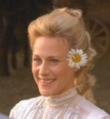
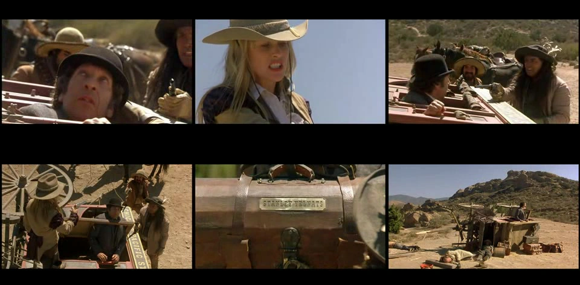

# Holes – Belangrijke Voorwerpen, Elementen, Symbolen en Lore

In *Holes* bezit elk voorwerp, dier en liedje een dubbele historische lading. Louis Sachar weeft een web van motieven waarin voorwerpen uit de negentiende eeuw een eeuw later letterlijk het leven van de hoofdpersonen redden. Dit document analyseert de meest iconische elementen, voorwerpen en lore van het universum van *Holes*.

---

## Inhoudsopgave
1. [Sploosh: De Zoete Verlossing](#sploosh-de-zoete-verlossing)
   - [De 110 Jaar Oude Ingemaakte Perziken van Kate Barlow](#de-110-jaar-oude-ingemaakte-perziken-van-kate-barlow)
   - [De Voetenspray van Stanley Yelnats III](#de-voetenspray-van-stanley-yelnats-iii)
2. [Mary Lou: De Ezel en de Roeiboot](#mary-lou-de-ezel-en-de-roeiboot)
   - [De 50-Jarige Ezel van Sam de Uienman](#de-50-jarige-ezel-van-sam-de-uienman)
   - [Het Omgekeerde Scheepswrak op de Meerbodem](#het-omgekeerde-scheepswrak-op-de-meerbodem)
3. [De Lippenstiftbuis ("KB")](#de-lippenstiftbuis-kb)
   - [Vondst in het Zand en de Misleiding van The Warden](#vondst-in-het-zand-en-de-misleiding-van-the-warden)
   - [Symbool van Katherine's Transformatie](#symbool-van-katherines-transformatie)
4. [De Schatkist van Stanley Yelnats I](#de-schatkist-van-stanley-yelnats-i)
   - [De Metalen Koffer met Inscriptie](#de-metalen-koffer-met-inscriptie)
   - [Inhoud en Juridische Betekenis](#inhoud-en-juridische-betekenis)
5. [God's Thumb (Big Thumb Mountain)](#gods-thumb-big-thumb-mountain)
   - [Het Toevluchtsoord van Twee Generaties Yelnats](#het-toevluchtsoord-van-twee-generaties-yelnats)
   - [De Oase: Water en Wilde Uien](#de-oase-water-en-wilde-uien)
6. [De Gele Gevlekte Hagedis en Uienbloed](#de-gele-gevlekte-hagedis-en-uienbloed)
   - [De Anatomie en het Dodelijk Gif](#de-anatomie-en-het-dodelijk-gif)
   - [Immuniteit door het Eten van Uien](#immuniteit-door-het-eten-van-uien)
7. [Het Slaapliedje ("If Only, If Only")](#het-slaapliedje-if-only-if-only)
   - [De Oorsprong in Letland](#de-oorsprong-in-letland)
   - [De Tekst van de Yelnats-Familie](#de-tekst-van-de-yelnats-familie)
   - [De Tekst van de Zeroni-Familie](#de-tekst-van-de-zeroni-familie)

---

## Sploosh: De Zoete Verlossing

*De vindplaats van 'Sploosh' onder het wrak van de Mary Lou.*

Het woord **"Sploosh"** heeft in *Holes* twee fundamentele betekenissen die heden en verleden aan elkaar koppelen:

### De 110 Jaar Oude Ingemaakte Perziken van Kate Barlow
Tijdens haar jaren als geliefde onderwijzeres in Green Lake stond Katherine Barlow wijd en zijd bekend om haar familierecept voor ingemaakte perziken. Ze kookte de rijpe perziken met kaneel, kruidnagel en suiker in grote glazen weckpotten. 

Toen Sam werd vermoord en Katherine vluchtte, bleven er tientallen ongeopende weckpotten achter onder Sam's roeiboot Mary Lou. Door de luchtdichte afsluiting, de hoge suikerconcentratie en de conserveerkracht van kruiden bleef het brouwsel meer dan een eeuw bewaard in het zand. 

Wanneer Zero wegrent van het kamp, vindt hij de potten onder de boot. De gefermenteerde, bruine massa smaakt zoet en naar perziken. Zero noemt het spul **"Sploosh"**, vanwege het geluid dat het maakt wanneer je de pot opent en erin roert. Hoewel de bacterieculturen in de antieke jam Zero zware maagkrampen bezorgen, levert het suiker en vocht die hem letterlijk voor de hongerdood behoeden.

### De Voetenspray van Stanley Yelnats III
Jarenlang probeerde Stanley's vader, een onfortuinlijke uitvinder, een spray te ontwikkelen die voetgeur permanent elimineert en oude sportschoenen recycleert. Zijn appartement stonk continu naar kokende schoenen en rottende chemicaliën.

Op de exacte dag dat Stanley IV Hector Zeroni de berg op draagt en de vloek verbreekt, mengt zijn vader per ongeluk een aftreksel van perziken met uienextracten. De spray neutraliseert onmiddellijk elke vorm van stank en laat schoenen ruiken naar een frisse perzikboomgaard!

Honkballegende Clyde Livingston probeert het product uit en is dolenthousiast. Het product krijgt de commerciële merknaam **Sploosh** – dezelfde naam die Zero in de woestijn aan Kate's perziken had gegeven!

---

## Mary Lou: De Ezel en de Roeiboot

*Het wrak van Sam's roeiboot op de meerbodem.*

### De 50-Jarige Ezel van Sam de Uienman
Mary Lou was de trouwe metgezel van Sam de Uienman. Sam beweerde dat Mary Lou vijftig jaar oud was, en schreef haar buitengewone vitaliteit en glanzende vacht toe aan haar dagelijkse dieet van verse uien. Toen Sam werd gelyncht door Trout Walker en diens handlangers, schoten de moordenaars ook de weerloze ezel Mary Lou door het hoofd.

### Het Omgekeerde Scheepswrak op de Meerbodem
Sam had zijn houten roeiboot naar zijn ezel vernoemd: **Mary Lou**. Nadat Sam op het meer werd neergeschoten, dreef de boot stuurloos rond totdat het meer opdroogde. De boot kwam ondersteboven op de modderige bodem terecht.

Honderdtien jaar later fungeert de omgekeerde romp van de Mary Lou als een baken van overleving in de woestijn. Het creëert een schaduwrijke schuilplaats tegen de moordende zon en bewaart de potten Sploosh voor Zero en Stanley.

---

## De Lippenstiftbuis ("KB")

*Het gouden lippenstiftkokertje van Kissin' Kate Barlow.*

### Vondst in het Zand en de Misleiding van The Warden
Tijdens het graven stuit Stanley op een klein, cilindrisch voorwerp van massief goud. Aan de onderkant staat een gegraveerd hartje met de letters **KB**. Stanley vermoedt aanvankelijk dat het een pen of naaisetje is.

Omdat de informele kampregels voorschrijven dat X-Ray de vondst mag claimen, geeft Stanley de huls aan hem. De volgende ochtend "vindt" X-Ray de buis in zijn eigen gat. The Warden herkent het kokertje onmiddellijk als de lippenstifthuls van haar aartsvijand **Katherine Barlow**.

Omdat X-Ray claimde dat hij de buis in zijn gat vond, laat The Warden de jongens wekenlang het gebied rondom X-Ray's gat uitkammen. Hierdoor graven ze tientallen meters verwijderd van de werkelijke vindplaats – waardoor de echte schatkist ongestoord blijft liggen totdat Stanley en Zero 's nachts terugkeren naar het juiste gat!

### Symbool van Katherine's Transformatie
De lippenstiftbuis markeert de fatale overgang van Katherine Barlow van zachtmoedige dorpslerares naar wraakzuchtige seriemoordenares. De felrode lipstick waarmee ze de lijken van haar slachtoffers kuste, zat oorspronkelijk in dit gouden kokertje.

---

## De Schatkist van Stanley Yelnats I

*De kist met de naam Stanley Yelnats die honderdtien jaar verborgen bleef.*

### De Metalen Koffer met Inscriptie
De schat waar de Walker-dynastie drie generaties lang naar heeft gegraven, is een zware, met leer en metaal beklede reiskoffer. De kist werd gestolen door Kissin' Kate Barlow toen zij de postkoets van Stanley Yelnats I beroofde.

Aan de zijkant van de kist staat in sierlijke letters de naam van de rechtmatige eigenaar gegraveerd:
**STANLEY YELNATS**

### Inhoud en Juridische Betekenis
Wanneer The Warden de kist probeert op te eisen, wijst advocate Carla Morengo op de inscriptie. The Warden kan onmogelijk beweren dat de kist aan haar familie toebehoort wanneer de naam van haar gevangene er letterlijk op staat!

In de kist vinden de autoriteiten:
- Aandelenbewijzen en staatsobligaties die door samengestelde rente in een eeuw tijd explosief in waarde zijn gestegen.
- Kostbare juwelen, gouden munten en historische waardepapieren.
- Na verkoop van de obligaties en juwelen ontvangen Stanley IV en Hector Zeroni elk bijna **één miljoen dollar** netto.

---

## God's Thumb (Big Thumb Mountain)

*De rotsformatie die eruitziet als een reusachtige hand met opgestoken duim.*

### Het Toevluchtsoord van Twee Generaties Yelnats
Toen Stanley Yelnats I in de negentiende eeuw werd beroofd door Kate Barlow, lieten de bandieten hem zonder water achter in de brandende hitte. IJlend en stervend van de dorst zag hij aan de horizon een berg die leek op een gigantische opgestoken duim. Hij strompelde erheen en overleefde drie weken op de berg voordat hij werd gered door veedrijvers. Sindsdien vertelde hij over "God's Thumb" die hem had gered.

Ruim een eeuw later volgt Stanley Yelnats IV exact dezelfde route om zijn eigen leven en dat van Zero te redden.

### De Oase: Water en Wilde Uien
Bovenop God's Thumb ontdekken de jongens de bron van het wonder:
- Een natuurlijke bergstroom die koud, zuiver zoet water levert.
- Een gigantisch veld met wilde, zoete berg-uien (oorspronkelijk de geheime uientuin van Sam de Uienman).
- Het eten van de uien herstelt de vitamine- en mineralenbalans van de uitgehongerde jongens en laadt hun bloed vol zwavelverbindingen, wat hen later redt van de gele vlekkenhagedissen.

---

## De Gele Gevlekte Hagedis en Uienbloed

*De geelgevlekte hagedis – dodelijk voor mensen, tenzij ze doordrenkt zijn van uienbloed.*

### De Anatomie en het Dodelijk Gif
- **Vlekken**: Precies 11 gele vlekken op een geel-groen schubbenlijf.
- **Gebit**: Naaldscherpe, zwarte giftanden die diep in het vlees dringen.
- **Mortaliteit**: 100% fataal. Binnen enkele uren treedt verlamming, koorts en de dood in. Er bestaat geen serum tegen het gif.

### Immuniteit door het Eten van Uien
De hagedissen jagen op warmbloedige prooien en insecten, maar hebben een fysiologische walging van de geur en smaak van uien. Omdat Stanley en Zero dagenlang vrijwel uitsluitend wilde uien aten op God's Thumb, rook hun huid, zweet en bloed intens naar geconcentreerd uizensap. Wanneer tientallen hagedissen over hun lichamen kruipen in de schatkistkuil, proeven de reptielen het uienaroma en weigeren ze toe te happen.

---

## Het Slaapliedje ("If Only, If Only")

Het melancholieke slaapliedje vormt de muzikale rode draad die alle generaties verbindt. Het weerspiegelt het verlangen naar rust, thuis en vergeving.

### De Oorsprong in Letland
Madame Zeroni zong het lied oorspronkelijk in het Lets. Elya moest het elke dag zingen terwijl zijn varken dronk uit de bergbron.

### De Tekst van de Yelnats-Familie (Vertaald uit het Engels)
Sarah Miller Yelnats paste de tekst aan voor haar kinderen in Amerika:

> *"If only, if only, the woodpecker sighs,*  
> *The bark on the tree was just a little bit softer.*  
> *While the wolf waits below, hungry and lonely,*  
> *He cries to the moo-oo-oon,*  
> *If only, if only."*

*Nederlandse vertaling:*
> *"Was maar, o was maar, zo zucht de specht stil,*  
> *De schors van de boom maar een tikje zachter.*  
> *Terwijl de wolf wacht beneden, eenzaam en koud,*  
> *En huilt naar de ma-a-an,*  
> *Was het maar, was het maar zo."*

### De Tekst van de Zeroni-Familie
Aan het einde van het boek zingt Hector's moeder dezelfde melodie voor haar teruggevonden zoon, maar met een troostende, liefdevolle slotregel:

> *"If only, if only, the moon speaks to you,*  
> *My heart is with you wherever you go.*  
> *Sleep my sweet baby, the night is now calm,*  
> *The stars shine above you,*  
> *If only, if only."*

De cirkel van verdriet en vervloeking is hiermee voorgoed gesloten.
