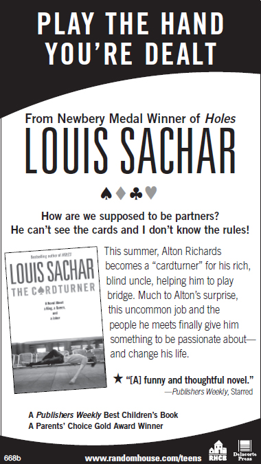

# Fuzzy Mud — Excerpt
**By Louis Sachar**

---

## **Read an excerpt from FUZZY MUD**

Excerpt copyright © 2015 by Louis Sachar. Published by Delacorte Press, an imprint of Random House Children’s Books, a division of Penguin Random House LLC, New York.

## Tuesday, November 2 11:55 a.m.

Woodridge Academy, a private school in Heath Cliff, Pennsylvania, Woodridge Academy, a private school in Heath Cliff, Pennsylvania, had once been the home of William Heath, after whom the town had been named. Nearly three hundred students now attended school in the four-story, black-and-brown stone building where William Heath had lived from 1891 to 1917, with only his wife and three daughters.

Tamaya Dhilwaddi’s fifth-grade classroom on the fourth floor had Tamaya Dhilwaddi’s fifth-grade classroom on the fourth floor had been the youngest daughter’s bedroom. The kindergarten area had once been the stables.

The lunchroom used to be a grand ballroom, where elegantly dressed couples had sipped champagne and danced to a live orchestra. Crystal chandeliers still hung from the ceiling, but these days the room permanently smelled of stale macaroni and cheese.

Two hundred and eighty-nine kids, ages five to fourteen, crammed their mouths with Cheetos, made jokes about boogers, spilled milk, and shrieked for no apparent reason.

Tamaya didn’t shriek, but she did gasp very quietly as she covered her mouth with her hand.

“He’s got this superlong beard,” a boy was saying, “splotched all over with blood.”

“And no teeth,” another boy added.

They were boys from the upper grades. Tamaya felt excited just talking to them, although, so far, she had been too nervous to actually say anything. She was sitting in the middle of a long table, eating lunch with her friends Monica, Hope, and Summer. One of the older boys’ legs was only inches away from hers.

“The guy can’t chew his own food,” said the first boy. “So his dogs have to chew it up for him. Then they spit it out, and then he eats it.”

“That is so disgusting!” exclaimed Monica, but from the way her eyes shone when she said it, Tamaya could tell that her best friend was just as excited as she was to have the attention of the older boys.

The boys had been telling the girls about a deranged hermit who lived in the woods. Tamaya didn’t believe half of what they said. She knew boys liked to show off. Still, it was fun to let herself get caught up in it.

“Except they’re not really dogs,” said the boy sitting next to Tamaya. “They’re more like wolves! Big and black, with giant fangs and glowing red eyes.”

Tamaya shuddered.

Woodridge Academy was surrounded by miles of woods and rocky hills. Tamaya walked to school every morning with Marshall Walsh, a seventh-grade boy who lived three houses down from her and on the other side of their tree-lined street. Their walk was almost two miles long, but it would have been a lot shorter if they hadn’t had to circle around the woods.

“So what does he eat?” asked Summer.

The boy next to Tamaya shrugged. “Whatever his wolves bring him,” he said. “Squirrels, rats, people. He doesn’t care, just so long as it’s food!”

The boy took a big bite of his tuna fish sandwich, then imitated the hermit by curling his lips so that it looked like he didn’t have any teeth. He opened and closed his mouth in an exaggerated manner, showing Tamaya his partially chewed food.

“You are so gross!” exclaimed Summer from the other side of Tamaya.

All the boys laughed.

Summer was the prettiest of Tamaya’s friends, with straw-colored hair and sky-blue eyes. Tamaya figured that was probably the reason the boys were talking to them in the first place. Boys were always acting silly around Summer.

Tamaya had dark eyes and dark hair that hung only halfway down her neck. It used to be a lot longer, but three days before school started, while she was still in Philadelphia with her dad, she made the drastic decision to chop it off. Her dad took her to a very posh hair salon that he probably couldn’t afford. As soon as she got it cut, she was filled with regret, but when she got back to Heath Cliff, her friends all told her how mature and sophisticated she looked.

Her parents were divorced. She spent most of the summer with her dad, and one weekend each month during the school year. Philadelphia was on the opposite end of the state, three hundred miles away. When she returned home to Heath Cliff, she always had the feeling that she’d missed something important while she’d been gone. It might have been nothing more than an inside joke that her friends all laughed at, but she always felt a little left out, and it took her a while to get back into the groove.

“He came _this close_ to eating me,” said one of the boys, a toughlooking kid with short black hair and a square face. “A wolf snapped at my leg just as I was climbing back over the fence.”

The boy stood on top of the bench and showed the girls his pant leg for proof. It was covered in dirt, and Tamaya could see a small hole just above his sneaker, but that could have come from

anything. Besides, she thought, if he’d been running _away_ from the wolf, then the hole would have been in the back of his pants, not the front.

The boy stared down at her. He had blue, steel-like eyes, and Tamaya got the feeling that he could read her mind and was daring her to say something.

She swallowed, then said, “You’re not really allowed in the woods.”

The boy laughed, and then the other boys laughed too.

“What are you going to do?” he challenged. “Tell Mrs. Thaxton?” She felt her face redden. “No.”

“Don’t listen to her,” said Hope. “Tamaya’s a real Goody Twoshoes.”

The words stung. Just a few seconds earlier, she had been feeling so cool, talking with the older boys. Now they were all looking at her as if she were some kind of freak.

She tried making a joke out of it. “I guess I’ll only wear one shoe from now on.”

Nobody laughed.

“You are kind of a goody-goody,” said Monica.

Tamaya bit her lip. She didn’t get why what she had said had been so wrong. After all, Monica and Summer had just called the boys _disgusting_ and _gross_ , but somehow that was okay. If anything, the boys seemed proud that the girls thought they were disgusting and gross.

_When did the rules change?_ she wondered. _When did it become bad to be good?_

Across the lunchroom, Marshall Walsh sat amid a bunch of kids, all laughing and talking loudly. On one side of Marshall sat one group. On his other side sat a different group. Between these two groups, Marshall silently ate alone.

## SunRay Farm

In a secluded valley thirty-three miles northwest of Woodridge Academy was SunRay Farm. You wouldn’t know it was a farm if you saw it. There were no animals, no green pastures, and no crops—at least, none that grew big enough for anyone to see with the naked eye.

Instead, what you would see—if you made it past the armed guards, past the electric fence topped with barbed wire, past the alarms and security cameras—would be rows and rows of giant storage tanks. You also wouldn’t be able to see the network of tunnels and underground pipes connecting the storage tanks to the main laboratory, also underground.

Hardly anyone in Heath Cliff knew about SunRay Farm, and Hardly anyone in Heath Cliff knew about SunRay Farm, and certainly not Tamaya or her friends. Those who had heard of it had only vague ideas about what was going on there. They might have heard of Biolene but probably didn’t know exactly what it was.

A little more than a year before—that is, about a year before Tamaya Dhilwaddi cut her hair and started the fifth grade—the United States Senate Committee on Energy and the Environment held a series of secret hearings regarding SunRay Farm and Biolene. The following testimony is excerpted from that inquiry:

**SENATOR WRIGHT:** You worked at SunRay Farm for two years before being fired, is that correct?

**DR. MARC HUMBARD:** No, that is not correct. They never fired me.

**SENATOR WRIGHT:** I’m sorry. I’d been informed—

**DR. MARC HUMBARD:** Well, they may have tried to fire me, but I’d already quit. I just hadn’t told anyone yet.

**SENATOR WRIGHT:** I see.

**SENATOR FOOTE:** But you no longer work there?

**DR. MARC HUMBARD:** I couldn’t be in the same room with Fitzy a minute longer! The man’s crazy. And when I say _crazy_ , I mean one hundred percent bananas.

**SENATOR WRIGHT:** Are you referring to Jonathan Fitzman, the inventor of Biolene?

**DR. MARC HUMBARD:** Everyone thinks he’s some kind of genius, but who did all the work? Me, that’s who! Or at least, I would have, if he had let me. He’d pace around the lab, muttering to himself, his arms flailing. It was impossible for the rest of us to concentrate. He’d sing songs! And if you asked him to stop,

he’d look at you like you were the one who was crazy! He wouldn’t even know he was singing. And then, out of the blue, he’d slap the side of his head and shout, “No, no, no!” And suddenly I’d have to stop everything I’d been working on and start all over again.

**SENATOR WRIGHT:** Yes, we’ve heard that Mr. Fitzman can be a bit … eccentric.

**SENATOR FOOTE:** Which is one reason why we are concerned about Biolene. Is it truly a viable alternative to gasoline?

**SENATOR WRIGHT:** This country needs clean energy, but is it safe?

**DR. MARC HUMBARD:** Clean energy? Is that what they’re calling it? There’s nothing clean about it. It’s an abomination of nature! You want to know what they’re doing at SunRay Farm? You really want to know? Because I know. I know!

**SENATOR FOOTE:** Yes, we want to know. That’s why you’ve been called before this committee, Mr. Humbard.

**DR. MARC HUMBARD:** Doctor.

**SENATOR FOOTE:** Excuse me?

**DR. MARC HUMBARD:** It’s “Dr. Humbard,” not “Mr. Humbard.” I have a PhD in microbiology.

**SENATOR WRIGHT:** Our apologies. Tell us, please, Dr. Humbard, what are they doing at SunRay Farm that you find so abominable?

**DR. MARC HUMBARD:** They have created a new form of life, never seen before.

**SENATOR WRIGHT:** A kind of high-energy bacteria, as I understand it. To be used as fuel.

**DR. MARC HUMBARD:** Not bacteria. Slime mold. People always confuse the two. Both are microscopic, but they are really quite different. We began with simple slime mold, but Fitzy altered its DNA to create something new: a single-celled living creature that is totally unnatural to this planet. SunRay Farm is now growing these man-made microorganisms—these tiny Frankensteins—so that they can burn them alive inside automobile engines.

**SENATOR FOOTE:** Burn them alive? Don’t you think that’s a bit strong, Dr. Humbard? We’re talking about microbes here. After all, every time I wash my hands or brush my teeth, I kill hundreds of thousands of bacteria.

**DR. MARC HUMBARD:** Just because they’re small doesn’t mean their lives aren’t worthwhile. SunRay Farm is creating life for the sole purpose of destroying it.

**SENATOR WRIGHT:** But isn’t that what all farmers do?

## Tuesday, November 2 2:55 p.m.

After school, Tamaya waited by the bike racks for Marshall. The racks were empty. Most of the students at Woodridge Academy lived too far away to ride their bikes, and there were no school buses for the private school. A line of cars extended from the circular driveway up Woodridge Lane toward Richmond Road.

As Tamaya watched the other kids climb into cars and drive off, As Tamaya watched the other kids climb into cars and drive off, she wished she had a ride too. She was already dreading the long walk home. It would feel even longer with a backpack full of books.

Her face still burned with shame every time she thought about what had happened in the lunchroom. She was mad at Hope for saying what she’d said, and even madder at Monica, who was supposed to be her best friend and who should have stuck up for her.

So she was a good girl? _So what?_ What was wrong with that?

Being good was partly what Woodridge Academy was all about. The students all wore school uniforms: khaki pants and blue sweaters for boys, plaid skirts and maroon sweaters for girls. Embroidered on each sweater, right under the name of the school, were the words _Virtue and Valor_ .

Besides learning about history and math and all that, the students at Woodridge Academy were also learning to be _virtuous_ . The school was supposed to teach them how to be good people. When Tamaya was in the second grade, she had to memorize a list of ten virtues: charity, cleanliness, courage, empathy, grace, humility, integrity, patience, prudence, and temperance. This year, she was learning their synonyms and antonyms.

But if you actually tried to be good, Tamaya thought bitterly, everyone acted like you were some kind of freak!

Marshall came out of the building. His hair was a mess, and his sweater, stretched out of shape, seemed to hang crookedly.

She didn’t wave. He came toward her, then trudged on past with hardly a glance.

Marshall had a rule. They weren’t supposed to act like friends around school. They were just two kids who walked to school together because _they had to_ . They definitely were not boyfriend and girlfriend, and Marshall didn’t want anyone thinking they were.

Tamaya was surprised, however, because he wasn’t going the usual way. Normally they headed up Woodridge Lane and then turned right on Richmond Road. Instead, Marshall was heading toward the side of the school.

She adjusted her backpack, then caught up to him.

“Where are you going?”

“Home,” he said, as if she’d just asked a really stupid question. “But—”

“I’m taking a shortcut,” he snapped.

That didn’t make any sense. They’d walked the same way every single day for the last three years. How could he suddenly know a shortcut?

He continued around the side of the school toward the back. He was taller than she was, and was walking quickly. Tamaya struggled

to keep up. “How do you suddenly know a shortcut?” she asked. He stopped and turned on her. “I don’t _suddenly_ know about it,”

he told her. “I’ve known about it my whole life.”

That didn’t make any sense either.

“If you want to take the slow way home, that’s up to you,”

Marshall said. “No one’s making you come with me.”

That wasn’t really true, and he knew it. Her mother didn’t allow

her to walk home alone.

“I’m going with you, aren’t I?” Tamaya said.

“Well, then quit being a baby about it,” said Marshall.

She stayed with him as he crossed the blacktop, then went out

onto the soccer field. All she’d done was ask how he knew a shortcut, she thought. How was that “being a baby”?

Marshall kept glancing behind him. Every time he looked back,

Tamaya instinctively did too, but she didn’t see anything or anybody.

Tamaya still remembered her first day at Woodridge. She’d been in the second grade, and Marshall had been in the fourth. He had helped her find her classroom, pointed out where the girls’ bathroom was, and personally introduced her to Mrs. Thaxton, the headmistress. The new school had seemed like a big, scary place to her, and Marshall had been her guide and protector.

She’d had a secret crush on him all through second, third, and fourth grades. Maybe it still lingered a little bit inside her, but lately he’d been acting like such a jerk, she wasn’t sure she even liked him anymore.

Beyond the soccer field, the ground sloped down unevenly toward the chain-link fence that separated the schoolyard from the woods. As they moved closer to the fence, Tamaya could feel her heartbeat quicken. The air was cool and damp, but her throat felt dry and tight.

Just a few weeks before, the woods had sparkled with bright fall colors. Looking out the window from her classroom on the fourth floor, she’d been able to see every shade of red, orange, and yellow, so bright some days that it had looked as though the hillside were

on fire. But now the colors had faded and the trees looked dark and gloomy.

She wished she could be as brave as Marshall. It wasn’t just the woods that scared her—and what might or might not have been lurking within. Even more than that, Tamaya was scared to death of getting in trouble. Just the thought of a teacher yelling at her filled her heart with fear.

She knew that other kids broke the rules all the time, and nothing bad ever happened to them. Kids in her class would do something wrong, and then her teacher, Ms. Filbert, would tell them not to do it, and then they’d do it again the very next day and still not get in trouble.

Still, she was sure that if she went into the woods, something horrible would happen to her. Mrs. Thaxton might find out. She could get expelled.

A dip in the rocky ground created a gap big enough to crawl through under a section of the fence. Tamaya watched Marshall take off his backpack, then push it through the gap.

She took off her backpack too. Ms. Filbert had once said that courage just meant pretending to be brave. “After all, if you’re not scared, then there’s nothing to be brave about, is there?”

Pretending to be brave, Tamaya shoved her backpack through the gap. There was no turning back.

_Now who’s the goody-goody?_ she thought.

She wiggled under the fence, careful not to snag her sweater.

**Find out more about Armpit and X-Ray after they’ve been released from Camp Green Lake** .
