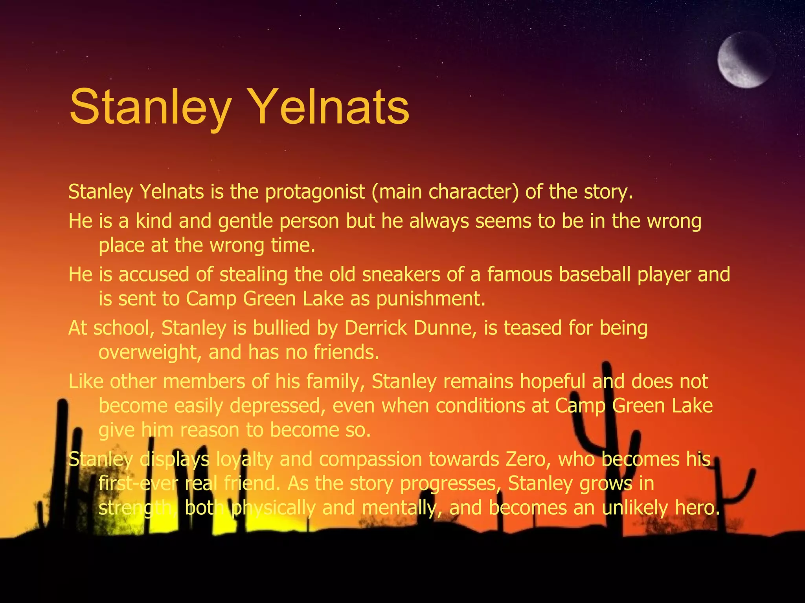
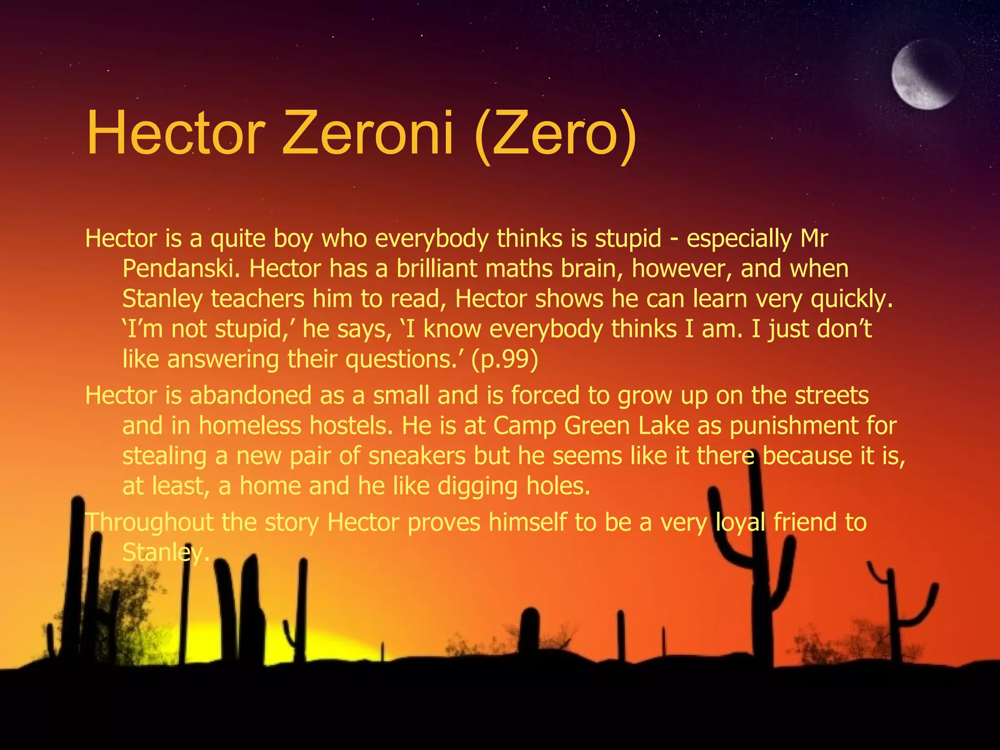

# Holes (Louis Sachar) — Comprehensive Character and Literary Analysis Guide for Holes Exam Study Suite
*An exhaustive, structured study compendium for secondary/high school literature exams, essay preparation, and interactive Q&A sessions on the characters of Louis Sachar's 'Holes'.*

---

## 1. Introduction and Structural Multi-Strand Overview

Louis Sachar's *Holes* (1998) is structured around three seamlessly intertwined timelines that converge in the present day of protagonist Stanley Yelnats IV:
1. **The Modern Timeline (Camp Green Lake, Texas)**: Stanley Yelnats is wrongfully convicted of stealing the sneakers of baseball superstar Clyde "Sweet Feet" Livingston and sent to a Texas juvenile labor camp. Here he meets Hector Zeroni ("Zero") and is forced to dig five-foot holes daily under the tyrannical rule of the Warden.
2. **The 19th Century in Latvia (The Curse of Elya Yelnats)**: Stanley's great-great-grandfather Elya courts Myra Menke, receives a piglet from Egyptian seer Madame Zeroni, but breaks his vow to carry her up the mountain, instigating a multi-generational family curse.
3. **Old Green Lake, Texas (circa 1888 — The Tragedy of Katherine & Sam)**: Green Lake is a flourishing paradise. Beloved schoolteacher Katherine Barlow falls in love with African-American herbalist Sam. Driven by racism, Trout Walker's mob murders Sam. Katherine transforms into the feared outlaw Kissin' Kate Barlow, robbing Stanley Yelnats I and burying her fortune in the dried lakebed.

---

## 2. Central Protagonists

### 2.1 Stanley Yelnats IV ("Caveman")

* **Full Legal Name:** Stanley Yelnats IV
* **Camp Nickname:** "Caveman" (awarded by Tent D after standing up to the Lump in the Wreck Room)
* **Family Role:** Son of an eccentric inventor; great-great-grandson of Elya Yelnats. His palindromic name mirrors the cyclical nature of fate.

#### Physical Description and Transformation
At the novel's exposition, Stanley is an overweight, insecure, socially isolated fourteen-year-old boy bullied at school by Derrick Dunne. By the end of his stay at Camp Green Lake, grueling physical labor has hardened his physique, giving him dense muscle, calloused hands, endurance, and deep moral self-confidence.

#### Narrative Role & Bildungsroman
Stanley is the dynamic viewpoint character experiencing a coming-of-age transformation. Wrongfully convicted for sneaker theft, he navigates the social hierarchy of Tent D, forms a literacy partnership with Zero, ventures into the desert to rescue Zero at God's Thumb, and unknowingly breaks the generational curse by carrying Hector Zeroni up the mountain.

#### Key Quotes & Literary Analysis
1. *"I am in the right place at the right time."* (Stanley realizes that his apparent misfortune placed him precisely where he needed to be to break the curse and achieve justice).
2. *"He didn't want to dig any more holes. But he knew that if he walked out into the desert, he'd die."* (Illustrates his early struggle for survival).
3. *"Zero wasn't a nobody. He was somebody."* (Stanley's moral awakening against institutional dehumanization).

---

### 2.2 Hector Zeroni ("Zero")

* **Full Legal Name:** Hector Zeroni
* **Camp Nickname:** "Zero" (cruelly imposed by staff under the claim that his head is empty)
* **Family Role:** Great-great-grandson of Madame Zeroni; son of Mrs. Zeroni.

#### Physical Description and Background
Hector is the smallest camper in Tent D, featuring watchful dark eyes and a quiet, guarded demeanor. Homeless since early childhood after his mother disappeared, he never attended school and is functionally illiterate. However, he is exceptionally gifted in mental arithmetic and is the fastest digger in the camp.

#### Narrative Role & Rebellion
Zero is the real sneaker taker, having taken Clyde Livingston's shoes from a homeless shelter display out of sheer necessity. When Dr. Pendanski cruelly insults his intellect in Chapter 30, Zero strikes him with a shovel and flees into the desert. He survives on 110-year-old preserved spiced peaches ("Sploosh") under the wreck of the *Mary Lou*. When Stanley carries him up God's Thumb, Zero recovers on wild onions and water, confessing the sneaker theft. After unearthing the Yelnats suitcase, Zero uses his $1 million share to hire detectives and reunite with his mother.

---

## 3. The Inhabitants of Tent D (D-Tent Campers)

### 3.1 Rex Alvin Washburn ("X-Ray")
- **Role:** Undisputed alpha leader of Tent D.
- **Nickname Origin:** Pig Latin for Rex (Rex -> X-Ray).
- **Dynamic:** Despite his small stature and thick glasses, he controls the camp water queue and coerces Stanley into giving him the gold "KB" tube to earn a day off.

### 3.2 Theodore Johnson ("Armpit")
- **Role:** Physical muscle and enforcer of Tent D; earned his nickname after a scorpion bite.
- **Extended Fandom Lore:** Central protagonist of Louis Sachar's official sequel *Small Steps* (2006), working as a landscaper in Austin, Texas.

### 3.3 José ("Magnet")
- **Role:** Skilled pickpocket who steals Mr. Sir's sack of sunflower seeds; Stanley takes the blame to protect him.

### 3.4 Ricky ("Zigzag")
- **Role:** Volatile, paranoid camper with wild frizzy hair; attacks Stanley during the literacy dispute in Chapter 30.

### 3.5 Alan ("Squid")
- **Role:** Sarcastic bully who secretly weeps for his mother at night; asks Stanley to call his mother with a message of love upon release.

### 3.6 Brian ("Twitch")
- **Role:** Nervous car thief who replaces Zero; his babbling about clutches inadvertently teaches Stanley how to drive the water truck.

### 3.7 Lewis / Louis ("Barf Bag")
- **Role:** Stanley's predecessor in Tent D who deliberately stepped on a rattlesnake to escape the camp's forced labor.

---

## 4. Camp Staff and Administration

### 4.1 Louise Walker (The Warden)
- **Role:** Ruthless camp proprietor; granddaughter of Trout Walker.
- **Modus Operandi:** Forces boys to dig holes to find Kate Barlow's buried treasure; uses rattlesnake venom fingernail polish to terrorize staff and inmates.
- **Fate:** Exposed by attorney Carla Morengo, arrested, and forced to sell the family estate to the Girl Scouts.

### 4.2 Marion Sevillo ("Mr. Sir")
- **Role:** Chief counselor who wears a Stetson and constantly chews sunflower seeds after quitting smoking.
- **Vendetta:** After being scratched by the Warden's venomous polish, he takes revenge by pouring Stanley's water ration onto the sand.

### 4.3 Dr. Pendanski ("Mom")
- **Role:** Tent D counselor who feigns care while relentlessly bullying Zero and deleting his legal records to cover up his desert escape.

---

## 5. Historical Figures of 1888 Green Lake

### 5.1 Katherine Barlow ("Kissin' Kate Barlow")
- **Role:** Gentle 1888 schoolteacher famous for award-winning spiced peaches; transformed into a feared outlaw after Sam's lynching.
- **Trademark:** Kissed the men she robbed with bright red lipstick; robbed Stanley Yelnats I; died laughing from a yellow-spotted lizard bite.

### 5.2 Sam the Onion Man
- **Role:** African-American herbalist and onion vendor with his donkey Mary Lou; repeatedly declared *"I can fix that."*
- **Significance:** His medicinal sweet onions cured illness and repelled lizards; his racially motivated murder initiated the 110-year drought.

### 5.3 Charles "Trout" Walker
- **Role:** Arrogant, wealthy Green Lake landowner afflicted with fish-odor foot fungus ("Trout"). Led the racist mob that killed Sam, starting the family's obsessive treasure quest.

---

## 6. Latvian Ancestral Figures

### 6.1 Elya Yelnats
- **Role:** Stanley's 19th-century Latvian great-great-grandfather who sought Myra Menke's hand, received the piglet ritual from Madame Zeroni, but forgot his vow to carry her up the mountain, initiating the family curse.

### 6.2 Madame Zeroni
- **Role:** Wise, one-legged Egyptian elder residing in Latvia; great-great-grandmother of Hector Zeroni; placed the generational curse on Elya's lineage.

---

## 7. Comparative Character Matrix

| Character | Era | Key Symbol | Narrative Resolution |
|---|---|---|---|
| **Stanley Yelnats IV** | Modern Day | Shovel, Palindrome | Matures, breaks curse, receives $1 million |
| **Hector Zeroni** | Modern Day | Sploosh, Lullaby | Achieves literacy, reunited with mother |
| **Louise Walker** | Modern Day | Venom Polish | Arrested, Camp Green Lake closed |
| **Katherine Barlow** | 1888 Green Lake | Red Lipstick, Peaches | Dies laughing from lizard bite |
| **Sam the Onion Man** | 1888 Green Lake | Sweet Onions | Murdered on lake; legacy protects boys |
| **Charles Walker** | 1888 Green Lake | Rotting Fish Feet | Dies destitute digging in the drought |
| **Elya Yelnats** | 1850s Latvia | Piglet, Broken Oath | Died in America; curse lifted by Stanley IV |
| **Madame Zeroni** | 1850s Latvia | Mountain Stream | Reconciled through Hector and Stanley |
